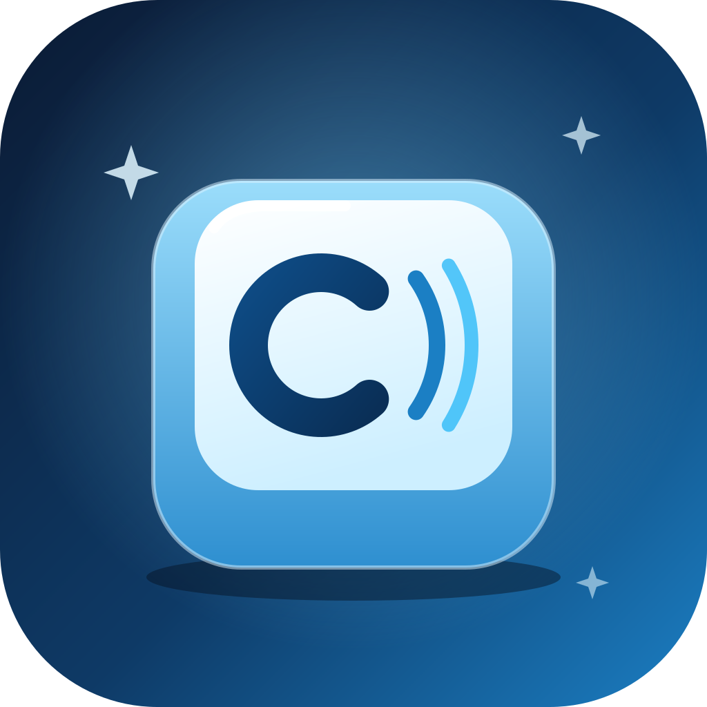

<p align="center">
  
</p>

<h1 align="center">Clicky</h1>
<p align="center"><b>by Heyrishi</b></p>
<p align="center">Realistic mechanical keyboard sounds for every keystroke, on macOS, Windows and Linux.</p>

<p align="center">
  <a href="https://github.com/rysusevaiye/clickyyy/releases/latest"></a>
  <a href="https://github.com/rysusevaiye/clickyyy/actions/workflows/ci.yml"></a>
  <a href="LICENSE"></a>
</p>

---

Clicky runs in the background (in the tray or menu bar) and plays a mechanical keyboard sound every time you press a key, in any app.

| Key | Sound |
| --- | --- |
| Letters, numbers, punctuation | **Click**: crisp tactile bump and bottom-out |
| Space | **Thock**: deep, thick spacebar |
| Enter / Return | **Clack**: heavy, hollow stabilized key |
| Backspace, Delete, Shift, Ctrl, Alt, Cmd/Win, Caps Lock | **Snap**: tight, punchy strike |
| Releasing any key | **Top-out**: soft upstroke |

- **One sound per press.** Clicky tracks which keys are held, so OS key repeat never retriggers the sound. Letting go plays the softer top-out sound.
- **Ultra-low latency.** Keystrokes are captured on a dedicated high-priority thread and passed lock-free to a real-time mixer. The mixer plays pre-decoded samples from a ~5 ms output buffer.
- **Three sound profiles.** Switch any time from the window or the tray menu:
  - **Crisp** (default): clean, dry, un-exaggerated switches with sharp micro-transients
  - **Creamy**: warm, deep PBT thock with case resonance
  - **Classic**: bright, lively clicky switches
- **Natural variation.** Five variants per sound, chosen at random, with slight per-hit volume changes.
- **Choose your speakers.** Send Clicky to any output device. Bluetooth adds delay no app can remove, so pick built-in or wired speakers for the fastest clicks, even while your music stays on Bluetooth. The default follows the system output.
- **Minimal UI.** Master volume, mute, output device, sound previews, run-in-tray and start-minimized options. Settings are remembered.

## Download

Get the latest build from **[Releases](https://github.com/rysusevaiye/clickyyy/releases/latest)**:

| Platform | File |
| --- | --- |
| macOS 11+ (Apple Silicon & Intel) | `Clicky_x.y.z_universal.dmg` |
| Windows 10/11 | `Clicky_x.y.z_x64-setup.exe` (or `.msi`) |
| Linux | `.AppImage`, `.deb` or `.rpm` |

### First run

**macOS.** The app isn't notarized, so macOS may say it "can't be opened" or is "damaged". Move Clicky to Applications, then run:

```bash
xattr -cr /Applications/Clicky.app
```

Clicky then asks for **Input Monitoring** access (System Settings › Privacy & Security › Input Monitoring). Turn it on and click **Relaunch** if Clicky asks.

**Windows.** SmartScreen may warn about an unrecognized app. Click **More info › Run anyway**.

**Linux.** Global key capture uses X11. On Wayland it only hears keys typed into X11/XWayland apps, so use an X11 session for system-wide sounds. The tray icon needs a system tray (AppIndicator) extension on GNOME.

## Custom sounds

Click **Custom sounds…** in the app to open your sounds folder, and drop in WAV files named after the sound they replace:

```
click_1.wav  click_2.wav  thock_1.wav  clack_1.wav  snap_1.wav  topout_1.wav ...
```

Restart Clicky to load them. Any category without custom files keeps the built-in sounds.

Custom files replace that sound in every profile. The built-in profiles are synthesized from physical models by [`scripts/profile_crisp.py`](scripts/profile_crisp.py), [`scripts/profile_creamy.py`](scripts/profile_creamy.py) and [`scripts/profile_classic.py`](scripts/profile_classic.py) (Python, standard library only). Run `npm run sounds` to regenerate them into `assets/sounds/<profile>/`.

## Building from source

Requirements: [Rust](https://rustup.rs), Node.js 18+, and the [Tauri prerequisites](https://v2.tauri.app/start/prerequisites/) for your OS. On Linux you also need `libasound2-dev libx11-dev libxtst-dev libxi-dev`.

```bash
npm install
npm run dev     # run in development
npm run build   # build installers into src-tauri/target/release/bundle
```

Releases are built by GitHub Actions for all three platforms when a `v*` tag is pushed.

### Project layout

```
src-tauri/src/
  main.rs            app setup, tray, window, commands
  audio.rs           real-time mixer (cpal), sample loading and resampling
  keys.rs            sound profiles and held-key tracking
  listener_macos.rs  Quartz event tap (macOS)
  listener_rdev.rs   low-level hook / XRecord via rdev (Windows, Linux)
ui/                  window UI (HTML/CSS/JS)
assets/              logo and sound samples (one folder per profile)
scripts/             sound profile generators
```

## License

[MIT](LICENSE) © 2026 Heyrishi
